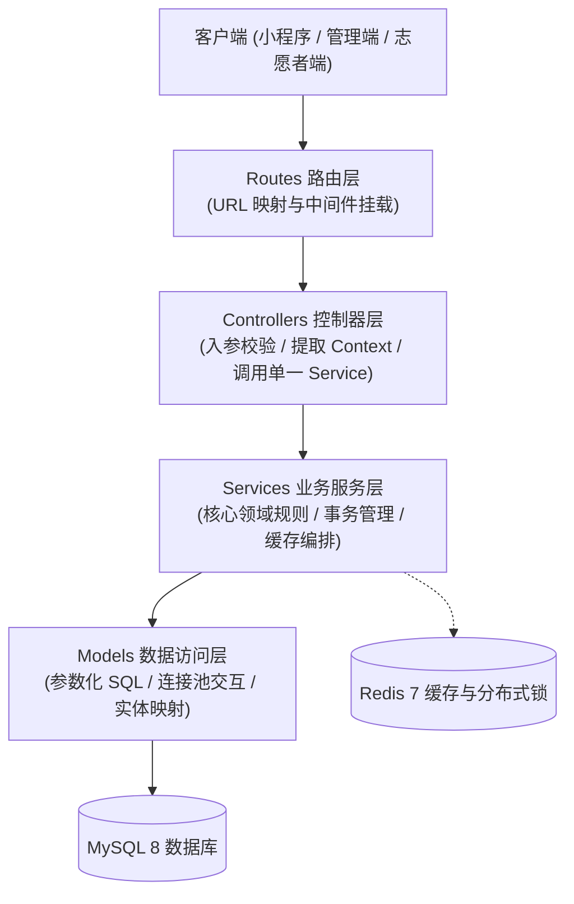

# 生产级后端分层架构规范 (Backend Architecture)

本技能为**银伴后端服务（Node.js 18 + Express 4 + MySQL 8 + Redis 7）**确立标准的三层单体模块化工程架构。通过严格的分层边界、严密的数据库事务与高效的缓存设计，确保系统具备高吞吐、高可靠与严密的业务一致性。

---

## 1. 架构核心原则与三层分层铁律 (Architectural Layering)

系统严格遵循以下分层调用约束，**严禁越级或逆向调用**：



### 1.1 刚性分层规约
1. **Controller 只调 Service**：
   - 严禁在 Controller 中编写 SQL 查询或直接引用 `database.js`。
   - 严禁跨 Controller 互相调用。
2. **Service 只调 Model**：
   - 严禁在 Service 中直接执行原生 SQL 拼接。
   - 跨模块业务复用（如 SOS 触发需同时调用短信通知服务），必须在 Service 之间以服务依赖注入形式协作。
3. **Model 才是唯一访问数据库的层次**：
   - 只有 `src/models/*.js` 允许 `require('../config/database')`。

---

## 2. 路由机制与双前缀挂载规范 (Routing & Dual Mounting)

为了同时兼容小程序客户端（通常约定 `/api/v1`）与管理后台/老版本端点，系统必须在 `server.js` 或 `app.js` 中保持**双前缀统一挂载**：

```javascript
// src/app.js 路由挂载标准
const express = require('express');
const routes = require('./routes');

const app = express();

// 1. 标准 v1 前缀挂载
app.use('/api/v1', routes);

// 2. 根路径挂载（非生产环境或向后兼容模式）
app.use('/', routes);
```

路由定义文件中必须按领域细分模块（如 `auth.routes.js`, `medication.routes.js`），并前置加载必要的身份验证（`authenticateJwt`）与权限校验中间件（`requireRole`）。

---

## 3. 控制器层规范 (Controller Layer)

Controller 职责必须极其纯粹，仅充当 HTTP 协议适配器：
1. **入参提取与验证**：从 `req.body`, `req.query`, `req.params` 提取数据，并使用模式校验（如 Joi / 手动防御）。
2. **提取上下文身份**：从 `req.user` 获取已认证的用户 ID 和角色。
3. **调用 Service 并统一输出**：
   - 成功时调用 `ok(res, data, message)`。
   - 异常时交由全局 `handleError(res, error)` 或错误拦截器统一处理。

```javascript
// src/controllers/medicationController.js 典型范例
const medicationService = require('../services/medicationService');
const { ok, fail } = require('../utils/response');

async function confirmMedication(req, res, next) {
  try {
    const userId = req.user.id;
    const { planId } = req.params;
    const { confirmationTime } = req.body;

    if (!planId) {
      return fail(res, 400, '用药计划 ID 缺失');
    }

    const result = await medicationService.confirmTakeMedicine(userId, planId, confirmationTime);
    return ok(res, result, '用药确认成功');
  } catch (err) {
    next(err); // 抛入统一错误处理中间件
  }
}
```

---

## 4. 服务层与 MySQL 事务管理 (Service Layer & Transactions)

Service 层是业务逻辑的绝对核心。所有多表变更、状态流转与数据一致性必须在此受控。

### 4.1 事务处理黄金模板
涉及跨表更新（如志愿者接单扣减积分、生成任务流转记录）时，必须严格使用数据库连接池事务：

```javascript
// src/services/volunteerService.js 事务范例
const pool = require('../config/database');
const volunteerModel = require('../models/volunteerModel');
const timebankModel = require('../models/timebankModel');

async function acceptTaskWithTransaction(volunteerId, taskId) {
  const connection = await pool.getConnection();
  try {
    // 1. 开启事务
    await connection.beginTransaction();

    // 2. 锁定并校验任务状态 (SELECT ... FOR UPDATE)
    const task = await volunteerModel.getTaskForUpdate(connection, taskId);
    if (!task || task.status !== 'OPEN') {
      throw { statusCode: 409, message: '任务已被其他志愿者认领或已关闭' };
    }

    // 3. 认领任务状态流转
    await volunteerModel.updateTaskStatus(connection, taskId, volunteerId, 'ASSIGNED');

    // 4. 预扣/结算积分记录
    await timebankModel.createPointsHold(connection, volunteerId, taskId, task.rewardPoints);

    // 5. 提交事务
    await connection.commit();
    return { taskId, status: 'ASSIGNED' };
  } catch (error) {
    // 6. 异常回滚
    await connection.rollback();
    throw error;
  } finally {
    // 7. 强制归还连接，杜绝连接池泄露枯竭！
    connection.release();
  }
}
```

---

## 5. Redis 缓存架构与防御机制 (Caching Discipline)

1. **统一 Key 命名空间规范**：
   - 格式强制为：`yinban:{module}:{entity}:{id}`
   - 示例：`yinban:medication:plan:u10023`、`yinban:auth:token:session_88192`。
2. **TTL 过期时间铁律**：
   - 任何写入 Redis 的业务缓存**必须设置显式 TTL（Time-To-Live）**，严禁使用不过期的持久化 Key 导致内存耗尽。
3. **缓存穿透与击穿防御**：
   - 查询数据库不存在的实体时，缓存存入短期空对象（`{ __null: true }`，TTL 60 秒），防止恶意高频刷库。
   - 热点数据更新采用分布式互斥锁（`SET key value NX EX`），保证同一时刻只有一个请求回源数据库。

---

## 6. 安全与中间件规范 (Security & Middleware)

- **Helmet & CORS**：强化 HTTP 响应头防护（XSS、Clickjacking、HSTS）。
- **速率限制 (Rate Limiting)**：对敏感接口（如 `/auth/sms-code`、`/auth/login`）配置 IP 和手机号维度的速率限制器（例如 1 分钟最多 5 次）。
- **统一响应与未捕获异常**：
  - 未捕获的 `404` 路由统一返回 `{ code: 404, message: "接口未找到", data: null }`。
  - 未捕获的系统崩溃错误统一输出 `{ code: 500, message: "服务繁忙，请稍后再试", data: null }`，严禁向客户端泄露 Node.js 内存堆栈（Stack Trace）。

---

## 7. 后端架构自查清单 (Architecture Checklist)

- [ ] 是否彻底杜绝了 Controller 中直接操作 SQL 的行为？
- [ ] 所有事务操作的 `finally` 块中是否均调用了 `connection.release()`？
- [ ] Redis 缓存是否均设定了合理的过期时间（TTL）？
- [ ] 生产环境是否关闭了堆栈向客户端直接抛出？
- [ ] 双路由前缀 `/api/v1` 与 `/` 是否均经过集成测试验证？
