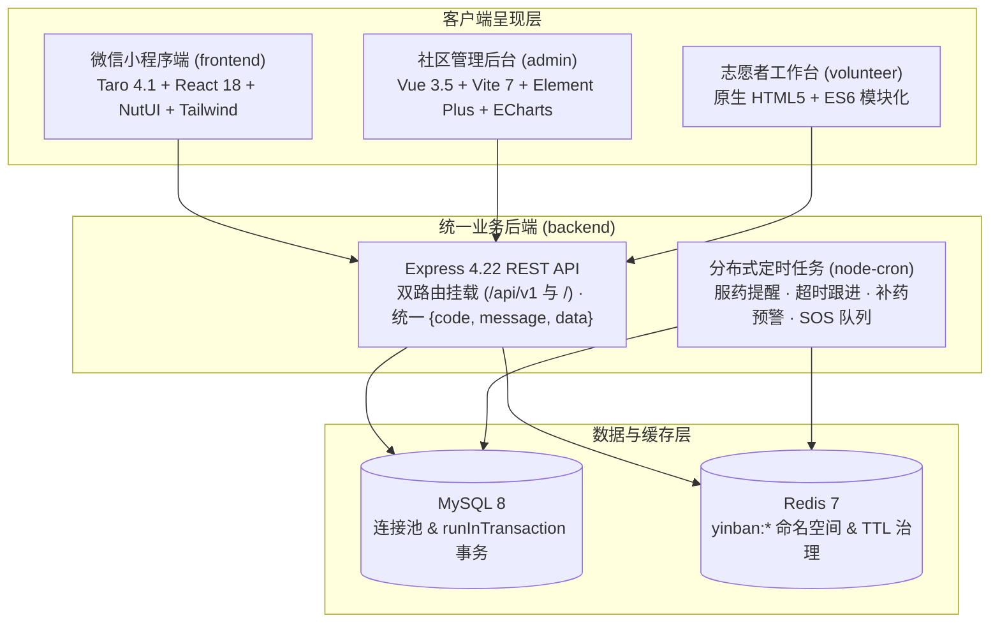

# 青松安护 · PineCare

> **面向中老年居家照护、亲情协同监护与社区网格调度的四端智慧照护平台**  
> （原“银伴”平台经全面架构瘦身、安全纵深加固与“暖玉微晶·液态温润”适老化重构后的正式开源发行版）

[](https://nodejs.org/)
[](./admin)
[](./frontend)
[](./TEST_READY.md)

---

## 目录

- [项目定位与设计理念](#项目定位与设计理念)
- [核心业务主线](#核心业务主线)
- [系统架构与技术栈](#系统架构与技术栈)
- [目录结构](#目录结构)
- [适老化视觉规范](#适老化视觉规范)
- [快速开始](#快速开始)
- [测试与质量保障](#测试与质量保障)
- [相关文档](#相关文档)

---

## 项目定位与设计理念

**青松安护（PineCare）** 寓意“如松长青，安稳守护”。针对传统养老产品功能堆砌、页面信息过载与暗黑极客风不适老的问题，项目遵循以下核心工程原则：

1. **聚焦四大刚需主线**：彻底收敛业务边界，所有代码与接口围绕“居家健康、紧急呼救、慢病用药、守护互助”四大刚需闭环构建。
2. **四端统一、前后端解耦**：一套后端服务支撑长辈端与家属端微信小程序、社区管理后台与志愿者轻量移动工作台。
3. **暖玉微晶·液态温润**：摒弃高刺眼纯白与暗黑风格，采用暖玉凝脂底色（`#F8F6F0`）配翡翠松青主色（`#1F6B56`），落实大字号、高对比度与防误触交互设计。

---

## 核心业务主线

| 业务主线 | 核心能力与关键接口 | 适用端 |
|---|---|---|
| **1. 居家健康监测 (`Health`)** | 今日体征总览（`/health/today`）、7 日/30 日趋势曲线（`/health/trend`）、手动录入与阈值预警（`/health/manual`）、智能设备绑定与同步（`/device/*`） | 长辈端 / 家属端 / 管理端 |
| **2. SOS 呼救与跌倒监测 (`SOS & Fall`)** | 一键 SOS 求助与 5 秒撤回窗口（`/sos/trigger`、`/sos/cancel`）、跌倒监测 15 秒倒计时防误报（`/fall-detection/*`）、短信/微信通知队列调度与事件时间线复盘 | 长辈端 / 家属端 / 管理端 |
| **3. 慢病用药提醒 (`Medication`)** | 用药计划编排（`/medication/plans`）、今日服药打卡与幂等防重复扣减（`/medication/confirm`）、月度遵从日历、分布式定时催服与余量预警 | 长辈端 / 家属端 / 管理端 |
| **4. 守护互助与社区协同 (`Mutual Aid`)** | 家属全景监护看板（`/family/elderly-overview`）、安全地理围栏（`/gps/*`）、社区助老工单调度（`/community/orders`）、志愿者接单/签到/签退全闭环（`/volunteer/*`） | 家属端 / 志愿者端 / 管理端 |

---

## 系统架构与技术栈



---

## 目录结构

```text
pinecare/
├── backend/              # Node.js 18+ / Express 4 核心服务、定时任务、迁移与全套测试
│   ├── src/
│   │   ├── config/       # 数据库、Redis 键命名空间 (redisKeys.js)、运行模式配置
│   │   ├── controllers/  # HTTP 请求解析与统一响应封装
│   │   ├── services/     # 核心业务逻辑与事务编排
│   │   ├── models/       # MySQL 数据访问层
│   │   ├── routes/       # 模块化路由注册与限流鉴权中间件
│   │   └── jobs/         # node-cron 定时调度与异步通知消费者
│   ├── migrations/       # 顺序 SQL 数据库迁移脚本
│   └── tests/            # 单元测试、集成测试、安全专项、合约测试与 Tier 1-5 E2E
├── frontend/             # 微信小程序端（长辈 / 家属双模式，Taro 4 + React 18）
├── admin/                # 社区运营管理后台（Vue 3 + TypeScript + Element Plus + ECharts）
├── volunteer/            # 志愿者轻量移动工作台（原生 ES Modules，零框架依赖）
├── specs/                # 核心业务模块 OpenAPI 3.1 契约与需求清单
├── design/               # 设计令牌与视觉规范文档
├── docker-compose.yml    # 一键拉起 MySQL + Redis + Backend 编排配置
├── PROJECT.md            # 架构契约与里程碑规划
├── TEST_READY.md         # E2E 黑盒测试体系就绪报告
└── REFACTOR_LOG.md       # 全周期重构与规范治理日志
```

---

## 适老化视觉规范

系统全面遵循“**暖玉微晶·液态温润（Warm Jade & Liquid Glass）**”视觉规范：

- **色彩体系**：
  - 画布底色：`#F8F6F0`（暖玉凝脂，降低高亮度纯白眩光）
  - 品牌主色：`#1F6B56`（翡翠松青，对暖玉底对比度 8.2:1，超越 WCAG AAA）
  - 关怀辅助色：`#C86D3B`（暖栗琥珀，用于服药与温和提醒）
  - 紧急急救色：`#D33833`（朱砂朱雀，用于 SOS 求助与跌倒预警）
- **交互与排版指标**：
  - 小程序端正文字号底线 `>= 16px`，核心生命体征指标 `36px–48px` 加粗呈现；
  - 管理后台辅助文本字号统一 `>= 14px`，图标图表内置 `shallowRef` 与自动 `dispose` 释放防泄漏；
  - 小程序采用纯 CSS 微晶质感，主包打包体积严格控制在 2MB 红线以内（当前实测 `553.29 KB`）。

---

## 快速开始

### 1. 环境准备

- **Node.js**：`>= 18.x`（管理后台建议 `20+`）
- **数据库与缓存**：MySQL 8.0 + Redis 7.0（或使用 Docker Compose）

### 2. 使用 Docker Compose 一键启动基础服务

```bash
docker-compose up -d
```

### 3. 启动后端服务 (`backend`)

```bash
cd backend
cp .env.example .env       # 按需填写 DB_HOST、REDIS_HOST、JWT_SECRET 等变量
npm install
npm run migrate            # 执行数据库表结构迁移
npm run dev                # 启动开发环境服务（生产环境使用 npm start）
```

> 生产模式（`RUNTIME_MODE=PRODUCTION_LIVE`）详细配置请参考 [`backend/.env.production-live.example`](./backend/.env.production-live.example) 与 [`系统真实配置与密钥清单.md`](./系统真实配置与密钥清单.md)。

### 4. 启动 / 构建各客户端

```bash
# 1. 微信小程序端 (frontend)
cd frontend && npm install
npm run typecheck          # TypeScript 类型检查
npm run dev:weapp          # 微信小程序开发监听（生产构建：npm run build:weapp）

# 2. 社区管理后台 (admin)
cd admin && npm install
npm run dev                # 启动 Vite 开发服务器（生产构建：npm run build）

# 3. 志愿者轻量工作台 (volunteer)
cd volunteer
npm run typecheck && npm run build
```

---

## 测试与质量保障

后端配备基于纯内存状态驱动的隔离测试套件，无需连接外部真实数据库即可完整验证：

```bash
cd backend

# 代码规范与格式化校验
npm run lint               # ESLint 严格模式（--max-warnings=0）
npm run format:check       # Prettier 格式检查

# 分层自动化测试
npm run test:security      # 安全边界与中间件套件（15 suites / 56 tests）
npm run test:e2e           # Tier 1–5 端到端与对抗测试（8 suites / 83 tests）
npx jest tests/unit tests/integration tests/contract --runInBand --coverage=false
                           # 单元、集成与接口合约全量回归（125 suites / 501 tests）
```

---

## 相关文档

- [架构契约与里程碑规划 (`PROJECT.md`)](./PROJECT.md)
- [E2E 测试体系报告 (`TEST_READY.md`)](./TEST_READY.md)
- [全周期重构治理日志 (`REFACTOR_LOG.md`)](./REFACTOR_LOG.md)
- [开发协作与构建速查 (`CLAUDE.md`)](./CLAUDE.md)
